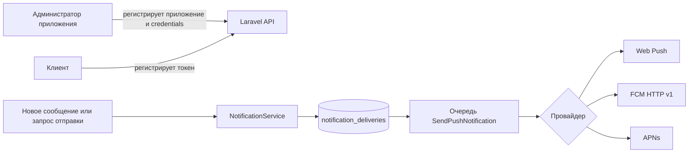

# Архитектура уведомлений

## Хранилище

- `notification_apps`: приложение, платформа, владелец, флаг активности.
- `notification_credentials`: один зашифрованный набор credentials на провайдера и приложение.
- `push_tokens`: зашифрованный токен, SHA-256 для поиска дубликатов, пользователь, приложение и сессия входа.
- `notification_deliveries`: запись каждой попытки доставки со статусом `queued`, `sent`, `failed` или `skipped`.
- `notification_preferences`: общие настройки пользователя.
- `messages.silent`: флаг тихого сообщения.

`devices` в существующем API описывает сессии входа и не используется для хранения push-токенов.

## Поток

Сообщения фильтруются по членству в диалоге, автору, mute, упоминанию и настройке пользователя. Каждое устройство получает отдельную запись доставки. Очередь повторяет временные ошибки до трёх раз. Credentials и токены не выводятся в API или журнал.

Для web-приложения сервер не читает пользовательские настройки уведомлений. Он не отправляет push из заглушённого диалога без упоминания, а остальные web push передаёт service worker. Локальные настройки браузера хранятся в `localStorage` и дублируются в Cache Storage, доступном service worker. Для нативных приложений серверные настройки продолжают действовать.

## Границы первой версии

- Приложениями и credentials можно управлять через Laravel-админку (`/notification-apps`) или REST API. Админка показывает только наличие credentials; приватные ключи доступны лишь для полной замены.
- Внешняя доставка зависит от действительных VAPID, Firebase и Apple credentials и работающего queue worker. Автоматические тесты используют локальную БД и не подтверждают приём реальными провайдерами.
- Подтверждение открытия уведомления, расписание, шаблоны и аналитика прочтений не реализованы.
- `desktopapp` использует Web Push. Для нативного транспорта desktop потребуется отдельный provider adapter.
- Скрытие браузерного push при видимом окне выполняет service worker. WebKit требует видимого уведомления для каждого принятого push и может отозвать подписку при скрытых уведомлениях; для строгой поддержки Safari потребуется фильтровать доставку по активности конкретного устройства на сервере.
