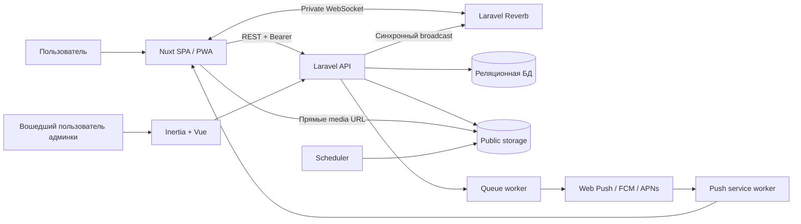
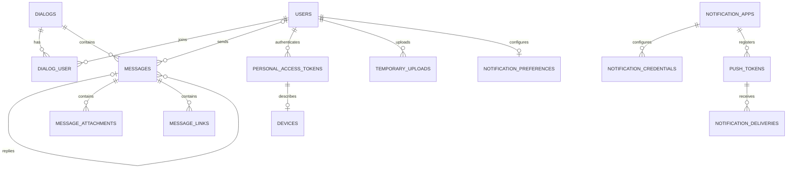
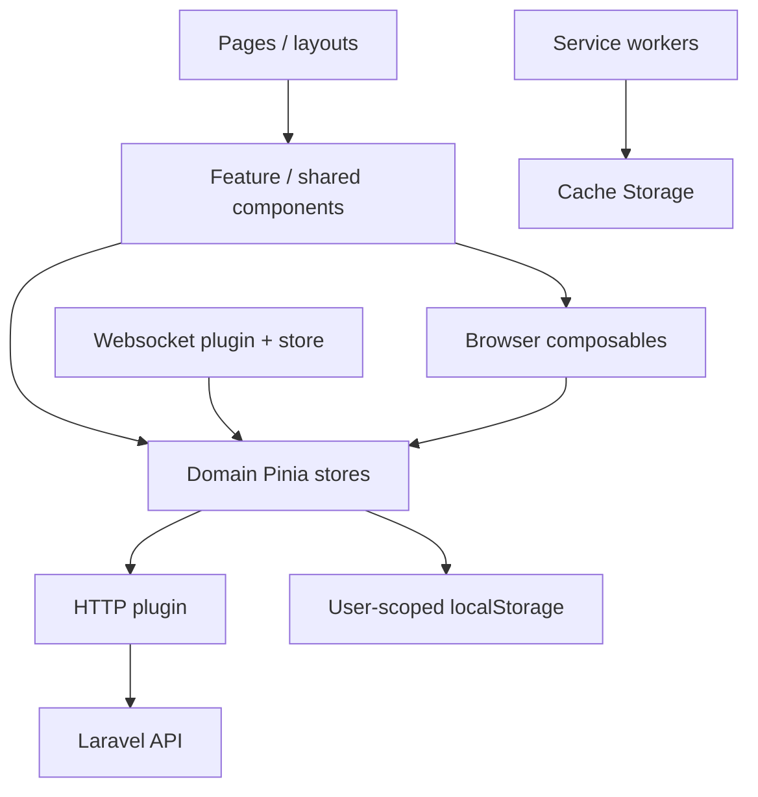

# Octo — архитектура

Дата: 12 октября 2026. Baseline: `13fad8a`. Факты описывают текущий код; раздел целевой архитектуры содержит предложения для стабильного первого релиза.

## Системный контекст

Это логические связи, а не утверждение о работающем production. В рекомендуемой существующей схеме Render API/админка/queue/scheduler объединены в контейнере, Reverb — отдельный сервис, Nuxt — static site, БД — PostgreSQL.

## Стек и границы

| Слой | Объявлено в коде | Ответственность |
| --- | --- | --- |
| API | PHP `^8.3`, Laravel `^13.0`, Sanctum `^4.3` | Валидация, авторизация, операции над данными |
| Realtime | Reverb `^1.10`, собственный websocket store | Каналы пользователя/диалога, события, typing/presence |
| Web | Nuxt `^4.4.2`, Vue `^3.5.32`, Pinia `^3.0.4` | SPA, маршруты, доменные stores, UI |
| UI | Nuxt UI `^4.7.0`, Tailwind `^4.2.4`, Tiptap | Компоненты, тема, редактор сообщений |
| Админка | Inertia Laravel `^3.1`, Inertia Vue `^3.4.0`, Vite | Управление пользователями, диалогами, notifications |
| Фоновые задачи | Laravel queue, database queue в примере deployment | Push, retries, scheduled cleanup |
| Хранение | Eloquent, SQLite в тестах, PostgreSQL в Docker deployment | Сообщения, участники, токены, deliveries |
| PWA | `@vite-pwa/nuxt`, Workbox, отдельный `push-sw.js` | App shell, runtime cache, браузерные push |

`ssr: false`; build может создавать Nitro server, но UI остаётся SPA. Docker использует PHP 8.4 и Node 22 для админских assets. Эти параметры описывают репозиторий, а не внешние требования последних релизов библиотек.

## Backend

### Модули

- **Identity:** Auth/Account/Device controllers, User, PersonalAccessToken, Device; определение устройства и GeoIP.
- **Dialogs:** Dialog/Group/Channel controllers, DialogAccess, DialogPermission, роли участников и приглашения.
- **Messages:** MessageController, MessageText, MessageLinkService, ответы, pins, cursor history, unread state.
- **Media:** UploadController, TemporaryUpload, MessageAttachment, скачивание и очистка временных файлов.
- **Realtime:** RealtimeController, DialogRealtime, DialogRealtimeEvent, `routes/channels.php`.
- **Notifications:** приложения, credentials, токены, preferences, delivery records, SendPushNotification, PushProvider.
- **Administration:** отдельные web controllers и Inertia UI, общие доменные модели.

Это логические модули единого Laravel-приложения. Изоляция ещё не оформлена в самостоятельные пакеты: существенная orchestration остаётся в контроллерах.

### API и доступ

REST находится под `/api/v1`. Login доступен без токена, остальные перечисленные API-функции защищены `EnsureBearerToken` и `auth:sanctum`. Клиент передаёт `Authorization: Bearer ...`, `Accept`, `Accept-Language`; cookie браузера не используются для аутентификации API (`credentials: 'omit'`).

Frontend сохраняет токен через JavaScript `useCookie('auth_token')`; это доступный скриптам bearer credential, а не HttpOnly session. Срок cookie и действительность серверного токена — разные вещи. Админка использует отдельную session-аутентификацию Laravel.

Доступ к операциям диалога определяет роль на pivot и `DialogAccess`. Каналы сейчас читаются по модели публичного канала: websocket authorization для `C` проверяет существование канала, без членства. Частные каналы нельзя обещать, пока отдельная модель видимости не реализована.

`/health` и `/api/health` возвращают ответ приложения; не проверяют всю цепочку БД/queue/Reverb/storage.

### Схема данных

Диаграмма показывает основные связи; nullable ownership и дополнительные FK приведены в миграциях.

IDs основных сущностей — UUID. Внешний идентификатор диалога содержит тип `D/G/C/B` и UUID; в личном диалоге он может представлять адресата и не равен физическому `dialogs.id`. Нельзя смешивать `dialog_id` таблицы и `dialog_public_id` событий.

`dialog_user` имеет составной ключ `(user_id, dialog_id)` и хранит role, permissions, muted, pinned, archived, last_read_at. Сообщения имеют reply FK, pin metadata, soft delete и индексы для истории `(dialog_id, created_at, id)` и связанных запросов. Поиск использует `LIKE`; наличие индексов истории не делает его полнотекстовым.

Черновики, выбранные папки-фильтры и часть настроек браузера не представлены серверными сущностями.

### Поток отправки сообщения сейчас

1. Store отправляет текст, optional reply, silent и IDs временных вложений.
2. API валидирует запрос, разрешает/создаёт direct dialog, проверяет send permission, reply и принадлежность uploads.
3. В DB transaction создаёт сообщение, перемещает файлы public disk, создаёт attachments, удаляет temporary records.
4. После transaction синхронизирует ссылки, загружает relations, синхронно отправляет realtime, вызывает push service.
5. Возвращает `201` с сохранённым сообщением. Realtime нормализуется на клиенте относительно текущего пользователя.

БД является источником истины. Файловые перемещения не транзакционны с БД; link sync и создание push deliveries происходят после основного commit. Ошибка после commit и потеря HTTP-ответа — разные сценарии, которые требуют безопасного повторного запроса.

### Realtime и push

`DialogRealtimeEvent` реализует `ShouldBroadcastNow`. Пользовательские события идут в private `user.{id}`, публичные каналы дополнительно в private `dialog.{publicId}`. Ошибка broadcast логируется и не откатывает сохранённое сообщение.

WebSocket store реализует ping/pong, backoff reconnect и повторные подписки. Plugin при восстановлении соединения обновляет dialogs и heartbeat; гарантированный replay всех пропущенных изменений текущей истории из этого кода не следует.

Push — отдельная доставка через очередь, не подтверждение сохранения/прочтения сообщения. Для web preferences локальны и доступны service worker через Cache Storage; для native серверные preferences участвуют в фильтрации. Подробнее: [существующий документ](../notifications/architecture.md).

### Встречи

Web-страница комнаты теперь является статическим UI-мокапом. Экран подготовки выделен в `components/feature/calls/CallsLobby.vue`, экран встречи со списком участников и подтверждением выхода — в `CallsRoom.vue`. Страница выбирает компонент через константу `isJoined`; по умолчанию отображается подготовка. Каждый компонент содержит собственные демонстрационные данные. Доступа к камере/микрофону/экрану, WebRTC, сигналинга, таймеров, storage и обработчиков действий в мокапе нет.

Backend authorization для private call channel пока сохранена, но эта страница его не использует. Возвращение реальных звонков потребует отдельного design, модели доступа и проверки внешних сетей.

## Frontend

Правила в [web README](../../apps/web/README.md): компоненты владеют presentation/forms/overlays, stores — HTTP и domain state. Composables координируют browser behavior, запросы делегируют stores. Reset/target change инвалидируют устаревшие результаты; uploads/downloads отменяют работу.

История выделена в message store, message-window utils и composables history/scroll/observers. Этот шов стоит сохранить: рендер, scroll intent и загрузка истории решают разные задачи. Calls page содержит только UI-шаблоны и демонстрационные данные; будущую orchestration звонков следует проектировать отдельно.

Workbox задаёт NetworkFirst для API (до суток), CacheFirst для avatars/media (до 30 дней), Range handling для media. Такие TTL — технические параметры текущего клиента, не договорённость о хранении приватных данных. Auth reset очищает stores и черновики, но не содержит общей очистки API/media Cache Storage.

## Целевая архитектура первого релиза — предложение

### Решение 1: сохранить единое приложение

Развивать модульный Laravel backend и Nuxt SPA. Выделить прикладные операции отправки/изменения сообщения и получения медиа по мере решения конкретных задач. Микросервисы, отдельный search engine и SFU не являются предпосылкой первого релиза.

Альтернативы: оставить текущую orchestration быстрее, но сложнее проверять partial failure; переписать на отдельные сервисы дороже и добавляет распределённые ошибки. Предлагается постепенное выделение application services с сохранением API-совместимости.

### Решение 2: единая модель авторизации

Добавить platform admin gate для web administration, отдельно от ролей диалога. Для media проверять доступ к сообщению/диалогу при выдаче оригинала и preview. Public avatars/публикации каналов отделить от private direct/group attachments явной политикой.

Для первого релиза предпочтительна выдача private media через авторизованный endpoint и загрузку Blob клиентским store. При необходимости streaming в media element — отдельное решение для короткоживущего URL; expiry, cache policy, revoke и range обязаны входить в его spec.

### Решение 3: предсказуемая отправка и восстановление

Добавить уникальность `(sender_id, client_message_id)` и возврат существующего результата при совпадающем payload. Повторное использование ключа с другим содержимым должно давать явный conflict. Клиент сохраняет один key на попытку сообщения и использует его при retry.

HTTP подтверждает сохранение; websocket ускоряет обновление. После reconnect текущая история сверяется через HTTP, включая edits/deletes/pins и unread. Для пилота достаточно ограниченного refetch видимого окна с сохранением scroll anchor; event replay/outbox рассматривается отдельно, если измерения и требования покажут необходимость.

Push и другие побочные действия должны повторяться безопасно и не превращать сохранённое сообщение в ответ «не отправлено». File lifecycle должен иметь компенсацию и проверку отсутствующих/orphan файлов.

### Решение 4: контролируемый offline и cache

На первом релизе сохранять app shell и явно разрешённые ресурсы. Выключить общий runtime cache авторизованных API-ответов, пока не появится модель cache namespace, очистки и freshness. Офлайн-отправку не обещать: сохранить черновик и объяснить недоступность сети.

При смене аккаунта очищать private browser data и отменять операции старой сессии. При обновлении SW удалить устаревшие cache namespaces, включая уже созданный `api-cache`. Проверить также push preferences и очередь уведомлений при переходе между аккаунтами.

### Решение 5: простой управляемый deployment

Оставить существующую topology для пилота. Добавить воспроизводимые проверки, readiness по зависимостям, мониторинг ошибок/failed jobs и доказанное восстановление БД и файлов. Смена public на private storage обязательна по политике данных; переход на object storage — отдельная задача, не автоматическое следствие наличия S3 config.

## Эксплуатационные ограничения

- Persistent disk предполагает один файловый узел; горизонтальное масштабирование требует общей storage strategy.
- `make dev/lan` не запускают queue worker; production Supervisor запускает queue и scheduler.
- CORS задаёт точные frontend/API origin; Reverb origin и security headers должны приниматься на фактическом HTTPS deployment.
- Schema migrations не заменяют перенос SQLite-данных в PostgreSQL; rollback кода не откатывает данные.
- APP_KEY нужен для encrypted notification credentials; восстановление без него может сделать данные непригодными.
- Полные тексты сообщений, Bearer-токены, push endpoints и credentials не должны попадать в диагностические журналы.

## Источники и связанные решения

Основные источники: [API routes](../../apps/api/routes/api.php), [web routes](../../apps/api/routes/web.php), [channel auth](../../apps/api/routes/channels.php), [MessageController](../../apps/api/app/Http/Controllers/Api/MessageController.php), [DialogRealtime](../../apps/api/app/Support/DialogRealtime.php), [Nuxt config](../../apps/web/nuxt.config.ts), [websocket plugin](../../apps/web/app/plugins/websocket.client.ts), [deployment](../deployment/render.md).

Продуктовая приёмка и пользовательские состояния: [design.md](design.md). Последовательность и критерии работ: [roadmap.md](roadmap.md).
