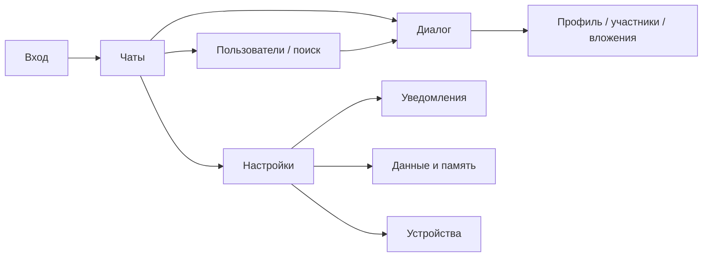
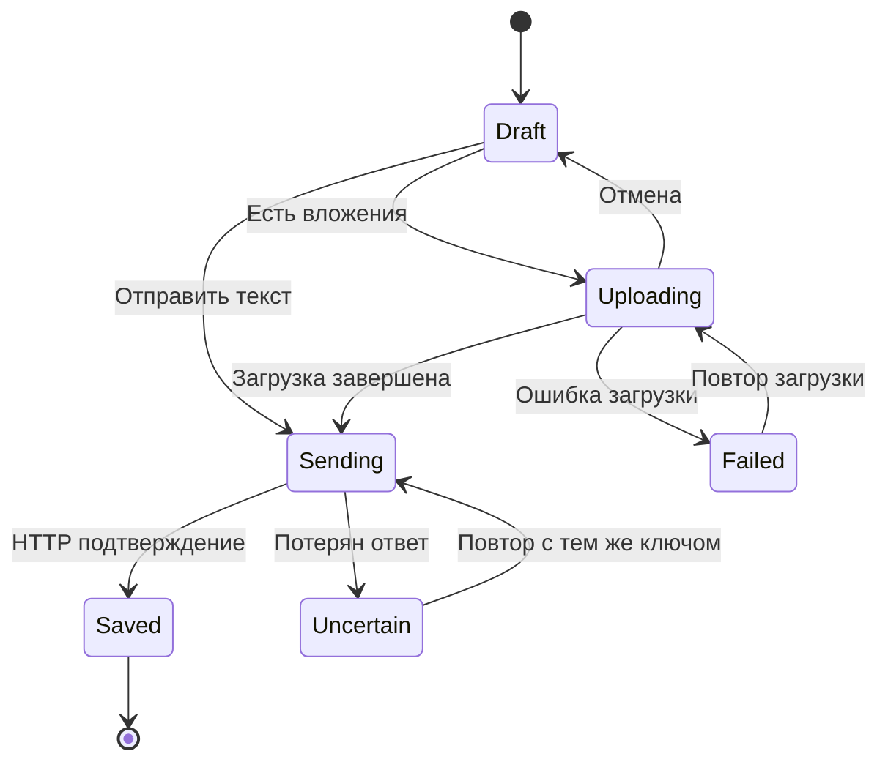

# Octo — дизайн стабильного первого релиза

Дата: 12 октября 2026. Статус: **предлагаемая спецификация для обсуждения и последующей реализации**. Основание: текущий проект `13fad8a`; целевая задача пользователя — стабильный первый релиз веб-мессенджера.

Дизайн включает продуктовые сценарии, UX/UI и технические требования. Это текстовый документ с критериями приёмки, а не набор проверенных в браузере макетов. Существующий UI описан по исходникам.

## Замысел и границы

Первый релиз должен позволить созданным администратором пользователям уверенно переписываться с телефона и desktop: войти, найти диалог, отправить текст/файл, увидеть новую историю, вернуться после потери связи и управлять уведомлениями.

В релиз включаются существующие личные диалоги, группы, публичные каналы, ответы/редактирование/удаление/pins, поиск внутри чата, архив, uploads, profiles, темы и Web Push. Встречи исключены из обязательной приёмки мессенджера, хотя прежняя WebRTC-логика восстановлена через отдельные страницы подготовки и комнаты и компоненты CallsLobby/CallsRoom. Публичная доступность встреч требует отдельной приёмки модели доступа и внешних сетей.

Не входят в обязательный первый релиз: открытая регистрация, billing/store, bots, stickers/GIF, scheduled messages, cross-device drafts, массовые конференции, reactions/forward/voice recording, E2EE. Для публичной регистрации и безопасного восстановления аккаунта потребуется отдельный spec.

## Выбор подхода

| Подход | Что даёт | Ограничение |
| --- | --- | --- |
| Стабилизировать существующее ядро — рекомендуется | Быстрее проверяемый релиз, опора на текущие tests/stores/UI | Часть новых функций откладывается |
| Сначала расширить коммуникации | Больше пользовательских возможностей | Добавляет состояния и нагрузку до закрытия текущих рисков |
| Сначала переписать архитектуру | Более строгие границы модулей | Долгий цикл без доказанной потребности пилота |

Предлагается первый подход с точечными изменениями backend boundaries, cache и отправки.

## Информационная архитектура

Текущие разделы sidebar: **Чаты, Пользователи, Сервисы, Настройки**. Desktop использует sidebar и рабочую область; ниже `lg` диалог занимает экран. Профили и настройки открываются overlays, есть интеграция с browser history.

В первом релизе сохранить эту структуру, сделать «Чаты» основным стартовым разделом. В сервисах показывать доступные функции; отключённые магазин/опросы/помощь не должны обещать пользователю работающий сценарий. Roadmap остаётся информационным экраном и должен показывать реальные статусы релизных этапов.

## Визуальная система

Существующая база: Nuxt UI, Tailwind, violet primary, neutral palette, светлая/тёмная тема, пользовательский radius и chat wallpapers. Её следует сохранить, унифицировав состояния и плотность.

| Элемент | Правило первого релиза |
| --- | --- |
| Цвет | Primary — основное действие/выбор; error — ошибка или разрушительная операция; статус обозначается также текстом/иконкой |
| Отступы | Предлагаемая шкала 4/8/12/16/24 px; единые отступы в однотипных списках |
| Текст | Предлагаемый body 14–16 px, основные формы 16 px на mobile; имена/даты не вытесняют содержимое |
| Touch targets | Предлагаемый минимум 44×44 CSS px для основных touch-контролов |
| Radius | Следовать выбранной теме; меню и списки не вводят собственную несогласованную систему |
| Wallpaper | Не ухудшать контраст текста/статусов в светлой, тёмной и пользовательской теме |
| Overlay | Один понятный заголовок, закрытие, возврат к прежнему экрану; destructive action с подтверждением |

Числа здесь — предложенные параметры приёмки, не описание уже измеренного UI. Основные размеры и breakpoint `lg` нужно проверять на итоговой сборке.

## Основные сценарии и состояния

### Вход и истечение сессии

Вход по username/password с индикатором операции и ошибками у полей. Пока запрос pending, повторный submit не создаёт вторую операцию. При неверных данных поля остаются заполненными, пароль не сохраняется в локальном хранилище.

При `401` пользователь видит понятное предложение войти снова; protected stores, requests, websocket и private cache предыдущей сессии очищаются. После повторного входа можно вернуться к разрешённому диалогу. Отзыв текущего устройства должен приводить к тому же состоянию при следующей защищённой операции.

### Список чатов

Loading, empty, error/retry и loaded существуют как отдельные компоненты. При временной ошибке обновления сохранять уже загруженный список, показывая состояние повторного запроса. Превью, draft indicator, unread и pin обновляются согласованно между списком и текущим диалогом.

Текущие «папки» — выбор встроенных фильтров; интерфейс не должен обещать пользовательские коллекции или синхронизацию с другими устройствами.

### Отправка и повтор

Это целевая модель, ещё не полностью реализованная. `Saved` означает сохранение сервером, а не прочтение адресатом. При неизвестном исходе нельзя показывать «точно не отправлено» и создавать новый key на retry. Composer/вложения сохраняются до подтверждённого результата или явной отмены.

Существующие лимиты по умолчанию: 4000 символов текста, 100 MB на сообщение-файл, 10 файлов, 5 MB на аватар. Frontend/backend значения должны совпадать для deployment; сообщение об ошибке указывает нарушенный лимит до повторной попытки.

### Чтение и история

При первом входе открывать корректную unread/latest позицию. Загрузка старых сообщений сохраняет видимый anchor. Новое сообщение не перемещает пользователя к концу, пока он читает историю; появляется индикатор новых сообщений. Переход из поиска/pin открывает конкретное сообщение и понятно выделяет его.

После reconnect сверять открытое окно истории и текущий dialog state. Удалённое/изменённое во время offline сообщение не должно оставаться навсегда в прежнем виде. На период восстановления не скрывать уже прочитанное содержимое и не сбрасывать scroll.

### Вложения

Выбор, drag/drop и paste используют одинаковый upload pipeline. Превью показывает тип, имя/размер и состояние. Отмена освобождает temporary resources; повтор относится к конкретному upload. Закрытие overlay и смена диалога имеют определённое поведение для активных операций.

Скачивание/просмотр private file допускаются только по действующим правам. После исключения из группы новые запросы оригинала, preview и range должны отклоняться. Уже скачанную пользователем копию отозвать невозможно; продукт не обещает такое удаление.

При недоступном Cache Storage экран объясняет, что оценка/очистка кэша недоступны, вместо ложного нулевого объёма. Очистка медиа не удаляет сообщения на сервере. Трафик показывается как локальная оценка приложения.

### Уведомления

Отдельно показывать: сервис не настроен; браузер/контекст не поддерживается; разрешение не выдано/заблокировано; подписка активна; операция не удалась. Разрешение запрашивать по действию пользователя. При запрете браузера дать инструкцию открыть его настройки.

Mute, mention override, silent, show names/text, sound и badge принимаются по матрице «видимое окно / фон / закрытая PWA / смена аккаунта». Отказ push не блокирует сохранение сообщений.

Переключатель настройки и кнопка не вкладываются друг в друга как два интерактивных контрола. Один пользовательский жест меняет значение один раз; label связан с switch, keyboard/focus работают. Это критерий задачи по текущему падающему тесту, а не предписание просто удалить тест.

### Права и недоступный диалог

Скрыть недоступные действия по permissions для удобства; сервер всегда повторно проверяет право. Удаление участника и отзыв роли должны отражаться без необходимости ручной перезагрузки. Не раскрывать private names/content пользователю, который потерял доступ.

Для первого релиза публичные каналы остаются публичными для авторизованных пользователей по текущей модели. Приватный канал потребует поля visibility и общих правил HTTP/WS/media.

## Mobile и доступность

- Проверить 360/390/430 px ширины и desktop 1280/1440 px, portrait/landscape, safe areas и soft keyboard.
- Composer остаётся доступен при открытии клавиатуры; длинные имена/ссылки не создают горизонтальный scroll страницы.
- Browser Back закрывает верхний overlay/диалог ожидаемым образом и сохраняет scroll списка.
- Focus возвращается к исходному контролу после закрытия modal; destructive action объясняет последствие.
- Icon-only controls имеют accessible names; ошибки/изменения операций доступны assistive technology.
- Разрешить масштабирование интерфейса: текущий viewport запрещает user scaling; изменение требует проверки mobile layouts.
- Проверить формы и сообщения на ru/kk/en; hardcoded Russian copy оформить как задачи перевода в пределах релизных экранов.
- Animations не обязательны для понимания состояния, учитывать reduced motion.

Это acceptance checklist. Соответствие стандартам доступности в текущем анализе не аттестовано.

## Технические требования

| Требование | Предлагаемое решение | Проверка |
| --- | --- | --- |
| Изоляция админки | Отдельная platform admin permission и server gate | Обычный пользователь получает отказ для каждого admin route |
| Private media | Private disk и единая проверка original/preview/download/range | Чужой пользователь и удалённый участник не получают данные |
| Safe retry | `client_message_id`, уникальность на пользователя, сравнение payload | Потеря ответа + retry создают ровно одно сообщение |
| Reconnect | HTTP reconciliation открытого окна и counters | Offline create/edit/delete/pin сходятся после восстановления |
| Cache isolation | Убрать общий auth API cache, очистить legacy cache, определить private cache lifecycle | A → logout → B → offline не показывает данные A |
| Partial failure | Явный lifecycle файлов и независимые побочные действия | Failure после commit не создаёт повтор/потерю данных |
| Предсказуемые формы | Раздельные request states и stale response guards | Ответ прошлого target не заменяет текущий экран |

API-изменения должны сохранять работоспособность старого клиента либо иметь явную стратегию обновления PWA. Детальные signatures, migrations и шаги реализации оформляются отдельно для каждого этапа roadmap.

## Приёмка первого релиза

1. Все backend/frontend тесты и обе сборки проходят воспроизводимо; проверяется также статическая frontend generation.
2. Два аккаунта в разных browser contexts обмениваются текстом/вложениями; reply/edit/delete/pin/search/unread корректны.
3. Повтор после неизвестного исхода не дублирует сообщение, reconnect восстанавливает изменения.
4. Роли, admin gate, private media, account switch и revoked device проверены отрицательными сценариями.
5. Mobile keyboard/scroll/overlays и ru/kk/en приняты на согласованной browser matrix.
6. Web Push проверен реальным провайдером и имеет работающее объяснение недоступности.
7. Backup восстановлен в отдельном окружении; deployment smoke и откат проверены.

Предлагаемая browser matrix: актуальные для команды Chrome desktop/Android, Safari macOS/iOS и Firefox desktop. Конкретные версии фиксируются при начале приёмки, а не угадываются по manifest.

## Открытые решения

До запуска пилота определить администратора/оператора, число пользователей, домены, browser matrix, правила хранения/удаления данных, допустимое время восстановления и критерий успешного пилота. Эти неизвестные не мешают выполнять подтверждённые задачи доступа, retry и tests; они влияют на релизную эксплуатацию.

Сроки и ресурсы пока не согласованы. Roadmap отражает порядок зависимостей, не календарные обещания. Для встреч отдельно решить публичность комнат, правила приглашения, лимит участников и необходимость TURN; для открытого продукта — регистрацию и recovery.
